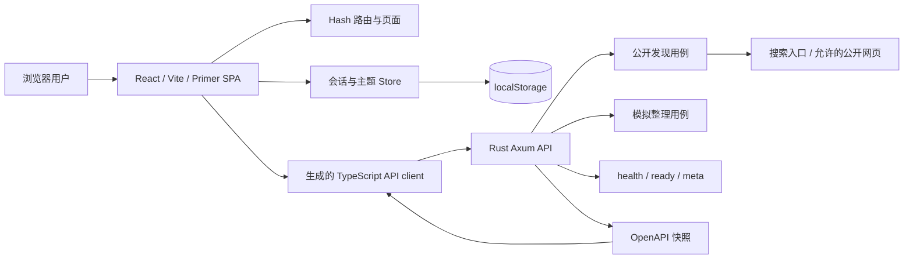
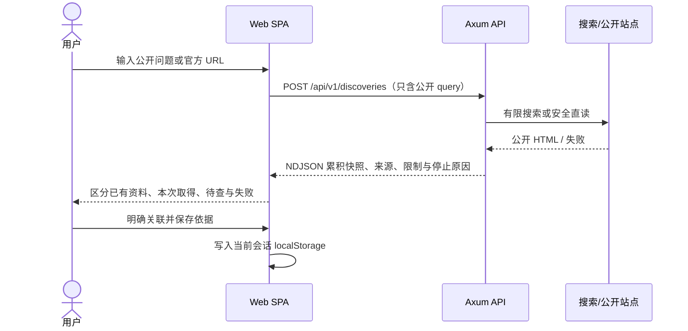
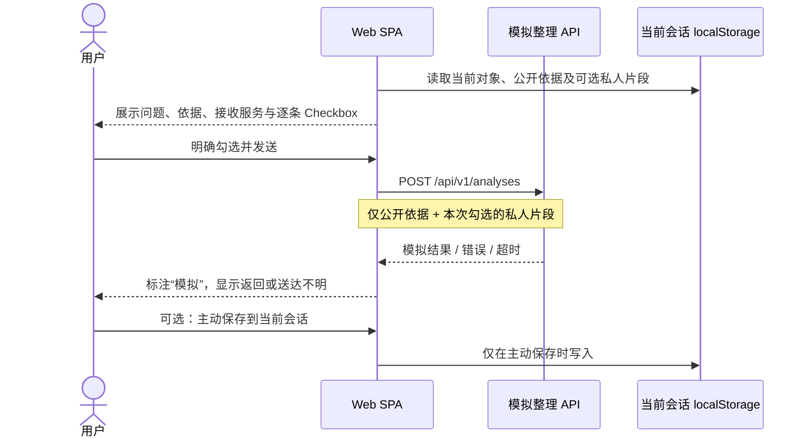

# 概要设计

Last updated: 2026-10-29

本文描述中期 demo 的实际运行架构。产品和页面行为分别见[需求规格](../project/requirements-spec.md)与[前端设计](../product/frontend-design.md)；接口字段以[API 契约](api-contracts.md)和生成的 OpenAPI 为准。

## 1. 设计目标与边界

- 一套前端支持所有机会类型的“探索 → 发现 → 处理”流程，选导师仅是内容最深的示例。
- 公共资料、实时发现与私人会话分开；来源、时间、未知、模拟状态可追溯。
- 中期 AI 整理使用本地模拟服务，不调用真实模型。
- 演示以本地 Web + API 为唯一部署目标，不声明生产、账号或跨设备能力。

## 2. 运行模块

### 2.1 Web SPA

`apps/web` 使用 React、Vite、Primer React/Primitives 和 Octicons。页面使用 `location.hash` 路由：首页、探索会话、资料库、对象详情、比较、我的探索和演示路线。全局上下文保存当前会话、比较选择和仅用于演示的模拟选项。

浏览器 Store 负责主题问题与条件、保存对象与依据、决定、私人理由／待问、上次比较和整理结果。数据写入当前 origin 的 `localStorage`；没有账号、同步或服务端备份。存储键和数据边界见[隐私文档](../product/privacy.md)。

### 2.2 TypeScript API client 与契约

`packages/api-client` 封装 Web 可用的请求、NDJSON 发现流和错误结构；类型由 `contracts/openapi.json` 生成。前端不直接手写后端 DTO。契约变化通过 `bun run api:check` 检查快照与生成代码漂移。

### 2.3 Rust API

`crates/api` 提供 Axum 路由、中间件、DTO、错误与 OpenAPI 导出；`crates/application` 承担发现和模拟整理用例。中期业务端点：

- `GET /healthz`、`GET /readyz`、`GET /api/v1/meta`；
- `POST /api/v1/discoveries`：无状态公开搜索／官网直读，JSON 或 NDJSON；
- `POST /api/v1/analyses`：无状态模拟整理，校验输入、延迟后回显接收范围并返回带来源引用的模拟结构。

API 不保存探索会话或私人片段；请求处理完即结束。发现只访问允许的公开来源，限制见[安全文档](../operations/security.md)。

## 3. 发现数据流

中止后前端保留已到正文并忽略迟到结果；取消不能撤回已发出的公开请求。固定资料不会冒充本次实时读取。

## 4. AI 整理与隐私边界

隐私边界：个人片段默认不选；其他会话不进入选择列表；服务端不记录正文或私人文本；超时和停止等待显示“可能已发送”，不宣称撤回。模拟服务只能验证流程，不能代表真实模型质量或数据处理承诺。

## 5. 关键数据关系

- **公共对象**：导师、实习、项目、竞赛、交流、活动、升学、资源、规则等，关联来源与时间。
- **参与途径／条件**：同一对象可有多条途径；硬要求、优先和建议分开；历史、未知、当前有依据分开。
- **探索会话**：问题、条件、保存对象、证据引用、决定和私人记录；同一公共对象在不同会话中有独立私人判断。
- **分析结果**：一次模拟整理的状态、问题、所用公开依据和已选择私人片段标识；只有用户主动保存才进入当前会话。

详细字段以[前端设计](../product/frontend-design.md)和 OpenAPI 为准。

## 6. 部署与运行

中期只支持本地开发部署：一个 Axum API 进程和一个 Vite Web 进程，浏览器固定打开 `http://127.0.0.1:5173`。浏览器 profile 或 origin 改变会形成不同存储空间。运行步骤见[用户手册](../project/user-guide.md)。容器、公开托管、备份、监控、账号和生产 SLO 不属于中期已实现能力。

## 7. 休眠与历史组件

- **PostgreSQL readiness**：`/readyz` 和 CI 仍保留 PostgreSQL 连通性检查，但当前发现／整理业务无数据库持久化。
- **`crates/db` 社区 migration**：现有 migration 是 2026 年 7 月旧社区方案，当前产品不读取其用户、帖子或审计表；仅作为历史兼容和 CI 负担保留。
- **Tauri 桌面壳**：仍在 workspace 和 CI 中编译，但不是中期运行目标，也不承载业务或本地能力桥接。
- **认证、论坛、归档、审核权限模型**：属于已废止社区路线，文档见[历史归档](../archive/architecture/auth-permissions.md)；不产生现行开发要求。

这些遗留组件是否删除或恢复须另作范围决定，不得因目录仍存在而推断产品依赖它们。

## 8. 2026-10-29 设计决定

2026-10-15 用户纠正了“其他类型不进首版”的旧口径；2026-10-29 明确所有类型在前端共用统一流程，导师保持最深内容，其他类型使用现有整理入口。中期 AI 整理必须连接明确标注的模拟服务，真实模型后置。这两项决定取代旧架构中“仅导师 UI”和“外部 AI 若采用”的歧义。
