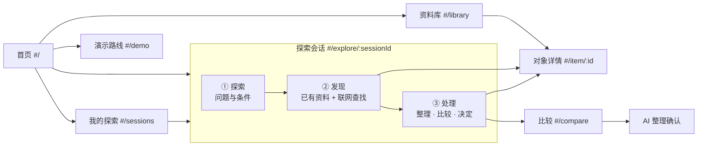

# 前端设计 v1.1（中期 demo）

Last updated: 2026-10-29

状态：2026-10-29 起由协调者（Claude）负责前端设计与实现，替代此前的 Kimi 专属规则（见 AGENTS.md）。本文依据[需求分析 v1.0](requirements-handoff.md)、[任务设计 v0.4](advisor-task-design.md)和[UI 规范](ui-system.md)；验收见[中期验收标准](../project/acceptance.md)。

v1.1 按用户 2026-10-29 的意见修改：

- 前端不再按“找导师”“找实习”分别组织路线，改为全量开放同一条“**探索 → 发现 → 处理**”流程，所有机会类型共用。
- 前端为其他类型留好入口，并验证这条流程可以复用、确实有效；内容深度沿用现有资料，不新增调研。
- 视觉风格参考优秀产品自行决定。参考来源与取舍见第 9 节，此前各轮 Kimi 设计稿只作参考输入。

## 1. 设计目标

1. **一条流程，所有类型**：科研与导师、实习、竞赛、交流与暑校、活动与讲座、升学、资源与支持、规则与认定，都走同一个探索会话。各类型的差异只体现在详情与比较的维度上。
2. **会话可接续**：一次探索就是一个会话，类似 agent 会话或研究会话。问题、发现过程、处理结论都留在会话里，下次回来接着做。
3. **依据可见**：每条信息标明来历——已有资料、本次取得、待查线索或模拟，附来源与时间；表格的每一格都能追溯到原文。
4. **按需与可结束**：详情、比较、AI 整理、准备建议都不是必经步骤；查到入口即可结束。
5. **私人与公开分开**：私人记录属于会话（主题）；只有用户在确认中逐条勾选的内容才会发出。
6. **克制而精致**：只用 Primer 组件，靠层级、节奏、一致的状态用语和真实进度把界面做好。

## 2. 信息架构



| 路由 | 视图 | 对应的用户任务 |
| --- | --- | --- |
| `#/` | 首页 | 入口 |
| `#/explore`、`#/explore/:sessionId?stage=explore\|discover\|process` | 探索会话 | T1 兴趣发现、T2 补查、T3 比较、T4 了解与准备、T5 保存与恢复 |
| `#/library?q=&type=` | 资料库 | T6 直达，也可不建会话直接浏览 |
| `#/item/:id` | 对象详情（所有类型） | T2、T4 |
| `#/compare?ids=&p=` | 比较（同类对象） | T3、补查回填、AI 整理 |
| `#/sessions` | 我的探索（会话列表） | T5 |
| `#/demo` | 演示路线 | 中期演示 |

- 一级导航四项：首页、探索、资料库、我的探索。
- 详情和比较是任务内视图。顶栏常驻“比较”按钮（带计数）。
- 未保存的探索是临时会话（`#/explore`），点“保存为探索主题”即持久化；会话与现有的“探索主题”是同一份存储。
- 路由使用 `location.hash`，不新增依赖。返回键、刷新和深链接都可用。

## 3. 全局外壳

- **顶栏**：左侧品牌标志加 Campus Lumen；中间 `UnderlineNav` 四项；右侧依次为：
  - 比较按钮（`CounterLabel`）；
  - 当前会话 `ActionMenu`，列出最近会话和“新的探索”；
  - 亮/暗切换 `IconButton`。

  窄屏下导航收进 `ActionMenu`。
- **页脚**：一行说明（信息以原站为准；探索记录只保存在本浏览器）和“演示路线”链接。
- **全局状态**：当前会话、比较栏、AI 模拟选项，都放在 React Context。

## 4. 探索会话

布局：`SplitPageLayout`。

- **左侧栏**是会话列表（`NavList`）：最近会话，每项显示名称、相对时间和阶段进度，并有“新的探索”。这一形式参考 Copilot agent 会话列表和 Perplexity 历史。窄屏下隐藏，由顶栏菜单代替。
- **主区**：
  - **会话头**：问题（h1，可点击编辑）、所选类型（`Token`）、条件摘要；
  - **阶段导航**：`UnderlineNav`，带计数和 URL：① 探索、② 发现（N）、③ 处理（N）；
  - **下一步提示**：阶段内容底部有一行“下一步”，随阶段变化，例如“已有 3 条发现，去处理”。

### 4.1 ① 探索：问题与条件

- **问题**：`Textarea`，占位“例如：想找本科阶段能参与的 AI 系统方向短期科研”。
- **类型**：复选组，默认不限；8 种类型，每种配 Octicon 与名称。
- **条件与偏好**：各自可选，不填也能继续。
  - 偏好（`preferences`，一个文本字段，自由填写参与目的、时间地点、已有基础、不考虑等）；
  - 不单独提供“参与目的” `SegmentedControl`。
- **发现计划**（只读预览）：
  - 将在已有资料中按问题匹配的类型与数量；
  - 联网时会发出的查询词，以及会发送到哪个服务。
- **按钮**：“开始发现”（进入 ② 并在已有资料中匹配，不联网）、“保存为探索主题”（临时会话可用）。
- **编辑**：修改问题或条件不会丢掉已存对象和私人记录，也不会自动发出查询（沿用 `TopicEditor` 的规则）。已保存会话的主题名也在 ① 探索 内编辑（“探索主题名称”字段），不显式引用独立的 `TopicEditor` 组件。

### 4.2 ② 发现：已有资料 + 联网查找

发现分两路，结果合并到同一份“发现列表”：

- **已有资料**：按问题和所选类型在资料库中匹配。每行显示：
  - 类型图标、名称·机构；
  - 一句概述；
  - 时效 `Label`（有依据 / 历史参考 / 未知）；
  - 来源数与采集日期；
  - 来历标签“已有资料”。
- **联网查找**：两种方式。
  - **关键词查找**：沿用发现接口，限定学术与招聘站点。
  - **直读官方页**：从已有资料匹配的对象中勾选，读取它们官方入口页的当前正文。适用于所有类型，这是验证“流程可复用”的关键。白名单外的网址明确提示“不在可读取范围，请打开原站”。
- **运行记录**：用 `Timeline` 展示本会话的每次查找，参考 Perplexity 和 Copilot 的过程日志。
  - 每次查找依次记录：检索“xxx” → 读取 N/5 → 每个来源一行（成功：标题、字数；失败：原因细分为无结果、搜索失败、正文读取失败）→ 结束状态（已完成 / 已中止 / 达到上限 / 失败）；
  - 运行中显示“中止”按钮和真实计数，不显示虚构的百分比；
  - 中止后保留已收到的正文，迟到结果不写入。
- **本次取得**：每条正文显示节选、匹配段落、取得时间，以及三个操作：
  - 关联到已有对象：系统给出候选，由用户确认；
  - 新建对象；
  - 忽略。

  只有同名不自动合并。
- **待查线索**：只有链接、没读到正文的结果，标“未读取正文”。
- **演示回放**：在演示路线中开启后，运行记录标题旁显示“演示回放（非实时）”。只能手动开启，联网失败时不会自动改用回放。

每行可直接“加入处理”：存入会话。临时会话会先提示保存为主题。

### 4.3 ③ 处理：整理 · 比较 · 决定

处理区是会话的工作台，参考 Elicit 的“结果 × 问题”表格和 GitHub Projects 的视图。

- **待处理提示**（有内容时置顶，`Banner` 或 `InlineMessage`）：关联待确认 N 条（误合并修正）、来源冲突 N 处、未读正文的线索 N 条。
- **视图**：`SegmentedControl`（全部 / 保留 / 待定 / 排除 / 未决定），切换的只是视图，不复制数据。
- **会话对象表**（`DataTable`）：
  - 列：对象（名称·机构，类型图标）、类型、时效、关键条件（一句）、依据（来源数·最近时间）、我的决定；
  - 行内操作：详情、加入比较、决定（`ActionMenu`：保留 / 待定 / 排除）；
  - 窄屏改为列表，每行显示同样的字段。
- **比较**：选中同类对象（2–4 个）后点“比较所选”，进入比较视图，并带上会话问题。不同类型不能混在一起比较，会提示先选同类。
- **AI 整理**：“按问题整理（模拟）”，整理当前视图中的对象，流程见第 6 节。
- **我的记录**：每个对象的私人理由与待问（展开编辑），只属于本会话。
- **下一步**：对“保留”的对象，汇总各自的准备重点与相关资源链接（来自对象详情），并提供“暂停这个探索”（只记一条备注，不推送提醒）。

## 5. 其他视图

### 5.1 资料库

- h1“资料库”，其下：
  - 搜索框，同时匹配名称、概述、条件和注意事项；
  - 类型 `NavList`：宽屏放左侧，窄屏改为 `Select`，每类附计数；
  - 开关“隐藏已结束的批次”。
- 结果为紧凑列表：类型图标、名称、机构或主办方、时效 `Label`、一句概述、来源时间。点击进入详情，行内可“加入比较”“加入当前探索”。
- 一行常驻提示：“可申请不等于获批，条件以原站为准。”

### 5.2 对象详情（所有类型共用骨架）

顶部：

- 返回链接；
- h1 名称；
- 元信息：类型 · 机构或主办方 · 来历 · 来源 N 条 · 最近采集；
- 操作：原站、直读官方页（联网补查）、加入比较、加入当前探索。

各节为 h2；某类对象没有的节就不显示：

1. **是什么**：导师写研究什么，实习写岗位与课题，其他类型写概述。
2. **怎样参与**：
   - 导师：按途径分子节（本科进组 / 短期科研或 RA / 研究生），每条途径有状态 `Label`（有依据 / 历史参考 / 未知 / 未提及），条件分硬要求、优先、建议三级；
   - 其他类型：显示适用对象与条件；
   - 外校或海外的前提单独标出。
3. **支持与费用**：有就显示。
4. **时效**：信息所属时期、当前状态（有依据开放 / 历史参考 / 未确认）。
5. **介绍之外**：
   - 有经历记录就列出，含角色、时期、来源；
   - 没有时写明缺口，给出公开的了解途径和待问事项清单，可一键加入我的待问；
   - 注明“本产品不收录私人联系方式，不评价导师品质”。
6. **准备重点（按需）**：`Details` 默认收起。每项写明做什么、为什么、来自哪里（来源建议或整理建议），并链接到相关资源条目。
7. **仍需确认**：未知项与冲突，冲突并排显示各来源说法。
8. **来源**：紧凑列表，每行是标题、方式、采集时间、原站链接；展开后显示范围与读取状态。

右侧窗格“我的记录”：当前会话中关于这个对象的理由与待问。

### 5.3 比较

- h1“比较”，其下：**当前问题**（默认取会话问题，可改，修改不会自动发请求）、对象列表（可移除或添加同类对象）、视角 `SegmentedControl`。
- **视角**：
  - 导师：研究方向 / 短期参与 / 研究生；
  - 实习：岗位与课题 / 成长途径 / 时间地点；
  - 其他类型：概况 / 条件与资格 / 支持与时间。
- **比较表**（`DataTable`）：
  - 行是问题，列是对象；
  - 每格有文字和来源链接，点击打开“依据”侧边 `Dialog`，显示原文节选、来源与时间，参考 NotebookLM 的引用回看；
  - 缺资料的格写“依据不足”，不打分。
- 窄屏改为按问题分组堆叠，每格前保留对象名。
- **补查**：“仍需确认”行的每格有“补查”按钮，打开侧边 `Dialog` 中的目标发现面板，预填“当前问题 + 对象名”，可直读官方页。保存后，结果以“补查所得（日期）”显示在该格内。
- **操作**：
  - 按问题整理（模拟）；
  - 保存这次比较：存入会话的“上次比较”；
  - 我的判断：每列的理由与待问，属于当前会话。

### 5.4 我的探索

- h1“我的探索”，列出所有会话，按最近活动排序。每行显示名称、问题、所选类型、对象数与决定分布（如“保留 2 · 待定 1”）、最后活动时间。可新建，也可删除（需确认）。
- 打开某行即进入该会话，并停在上次所在的阶段。

### 5.5 演示路线（`#/demo`）

- h1“演示路线”，按[演示脚本](../project/user-guide.md#演示脚本)列出步骤。每步写明操作、预期结果、实时或模拟标签，以及带预填参数的“前往”链接。
- **演示数据**：
  - 载入或清除两个合成示例会话，名称带“（合成示例）”；
  - AI 模拟结果：正常 / 延迟 3 秒 / 超时 / 服务错误；
  - 发现回放：逐条到达 / 部分来源失败 / 中止后迟到 / 达到上限。
- 页面顶部说明：这些开关只影响演示，不改公开资料。

## 6. AI 整理（模拟服务）

### 6.1 发送前确认（`Dialog`）

参考 NotebookLM 的“先选来源”：发送前由用户决定范围。

1. **本次问题**：可修改。
2. **公开依据**：自动列出比较表的格或处理表各对象的关键字段，附来源标题、网址、采集时间，可查看。
3. **个人内容**：只列当前会话中这些对象的理由和待问，每条一个 `Checkbox`，**默认全部不选**。其他会话的内容不会出现在列表里。
4. **接收服务**：模拟整理服务（本地 API `simulated-organizer`，不调用外部模型，不保存内容）；用途：按问题整理差异与待确认事项。
5. 底部显示“将发送：公开依据 N 条，个人内容 M 条”，按钮为“发送”和“不发送”。

### 6.2 发送状态

| 状态 | 进入条件 | 界面文字 |
| --- | --- | --- |
| 未发送 | 尚未点击发送，或在请求发出前取消 | 尚未发送 |
| 已发出，等待结果 | `fetch` 已调用 | 已发出，等待结果（可停止等待） |
| 已返回 | 收到 2xx | 已返回；服务回显：收到公开依据 N 条、个人内容 M 条 |
| 服务报错 | 收到非 2xx | 请求已送达，服务返回错误；内容可能已被接收 |
| 送达不明 | 超时、断网，或发出后才停止等待 | 发送状态未确认，可能已发送 |

停止等待只阻止后续操作，不会撤回已发出的请求。重试时显示当前勾选内容和上次状态，不会扩大范围，也不会自动重发。

### 6.3 结果

- 标题旁标注“模拟服务输出 · 请对照来源核实”。
- 结果分四节：差异要点、与你的问题有关、回应你选择的内容、仍需确认。每条附引用编号，链接到对应的公开依据，并注明回应的是哪条个人内容。
- 依据不足时直接说“现有资料没有覆盖”，不编造（参考 NotebookLM 只依据所给资料作答的做法）。
- “保存到本会话的整理记录”是私人保存，不保存就在离开时丢弃。

### 6.4 接口

`POST /api/v1/analyses`，`operation: "compare" | "shortlist"`。

请求体：

| 字段 | 内容 | 上限 |
| --- | --- | --- |
| `question` | 本次问题 | — |
| `subjects[]` | 对象，每个含 `id`、`name`、`kind` | 2–8 个 |
| `evidence[]` | 公开依据，每条含 `ref`、`subjectId`、`aspect`、`text`、`sourceTitle`、`sourceUrl`、`collectedAt` | 60 条 |
| `selectedPrivateFragments[]` | 个人内容，每条含 `id`、`kind`、`subjectId`、`text` | 10 条 |
| `simulation?` | `outcome`、`delayMs` | — |

响应包含：

- `analysisId`；
- `provider`：`simulated: true`，`retention: "none"`；
- `received`：回显收到的依据引用与个人内容编号；
- `sections[]`、`caveats[]`。

服务端不记录正文或个人内容，只记条数。

## 7. 数据设计

- **资料库条目**（`lib/catalog.ts`）：把现有的导师和实习候选（`Advisor`）与 26 条入口（`Opportunity`）统一成 `CatalogItem`：`{id, kind: advisor | internship | entry, types, name, org, summary, timing, sources | entry, …}`。原数据文件和解析规则不变，包括 `parseCollectedBatch`、误合并更正、实习纠错。
- **候选档案**（`lib/profiles.ts`）：为已整理的导师建立结构化档案，包括途径（状态与分级条件）、介绍之外、准备重点、未知与冲突。每条陈述绑定到该对象已有来源的 URL 与采集时间，绑定不上的不显示。没有档案的对象由通用规则从已有字段生成；用户填写的说明标“未自动核实”。
- **会话（主题）存储**沿用 `campus-agora:explorations:v1`，新增可选字段：
  - 主题：`types[]`、`stage`、`lastComparison`、`analyses[]`、`pausedNote`；
  - 记录：候选与入口记录各加 `decision?: keep | maybe | exclude`。

  旧数据无需迁移。
- 团队整理的说明都注明“整理建议”，与来源原文区分。

## 8. 视觉与交互规范

- **组件**只用 Primer：`SplitPageLayout`、`PageLayout`、`Stack`、`Heading`、`Text`、`Link`、`Label`、`StateLabel`、`CounterLabel`、`Token`、`NavList`、`ActionList`、`ActionMenu`、`UnderlineNav`、`SegmentedControl`、`DataTable`、`Dialog`、`Details`、`Timeline`、`Banner`、`InlineMessage`、`Blankslate`、`Spinner`、`SkeletonText`、`FormControl`、`Checkbox`、`Textarea`、`TextInput`、`Select`、`IconButton`。
- **层级**：h1 24 → h2 20 → h3 16（半粗）；正文 14，元信息 12 并用 muted 色。页面内容区用 `PageLayout` 的 large 宽度。
- **类型图标**（Octicons）：

  | 类型 | 图标 |
  | --- | --- |
  | 科研与导师 | `BeakerIcon` |
  | 实习 | `BriefcaseIcon` |
  | 竞赛 | `TrophyIcon` |
  | 交流与暑校 | `GlobeIcon` |
  | 活动与讲座 | `CalendarIcon` |
  | 升学 | `MortarBoardIcon` |
  | 资源与支持 | `ToolsIcon` |
  | 规则与认定 | `LawIcon` |

  图标始终配文字。
- **状态用语**（颜色只表示状态，并且始终配文字）：
  - 来历：已有资料 / 本次取得 / 待查线索 / 模拟；
  - 时效：有依据 / 历史参考 / 未知 / 未提及；
  - 决定：保留 / 待定 / 排除 / 未决定。
- **间距**只用 `Stack` 的 gap 档位；不写任何数值样式。
- **加载**（按 Primer loading 模式）：1 秒内无指示；1–3 秒用 `Spinner`；更久的查找走运行记录，显示真实阶段和计数，不阻塞页面。
- **空状态与降级**：空状态是一句原因加一个动作（`Blankslate`）；失败就地说明（`InlineMessage`）。保留全局导航，不用通用空状态掩盖失败。
- **保存**：显式保存；失败时保留输入；成功提示放在操作旁边。
- **键盘**：所有操作可用 Tab 到达；Dialog 打开时焦点进入、关闭时回到触发按钮；表格中的按钮带完整的可访问名称，例如“补查：宋卓然 仍需确认”。

## 9. 参考与取舍

调研记录见 `work/2026-10-29-midterm/ui-references.md`。来源为各产品的官方帮助文档与 Primer 模式文档。

| 参考 | 采用 | 不采用 |
| --- | --- | --- |
| Elicit（问题驱动的流程、结果 × 问题表格、逐格查看原文） | 探索 → 发现 → 处理的阶段结构；比较表与处理表；逐格依据侧栏 | 自动排除或筛选打分 |
| Perplexity（可接续的会话、过程可见、编号引用） | 会话列表；运行记录 `Timeline`；来源链接 | 以对话为主、来源藏在回答里的界面 |
| NotebookLM（先选来源再提问、有引用的回答、存为笔记） | AI 发送前逐条勾选范围；结果带引用；保存为整理记录 | — |
| GitHub Copilot 会话、GitHub Projects（会话收件箱、过程日志、视图切换） | 左侧会话栏；可中止并保留结果；“保留 / 待定 / 排除”视图 | — |
| DeepTutor（不同模式共享同一会话上下文） | 同一会话下的三个阶段 | 任务看板式卡片 |
| Consensus（论文速览、共识仪表） | 详情页的固定小节，缺项明确写“未提及” | 共识仪表与打分 |

## 10. 实现结构

```text
apps/web/src/
  app/        App.tsx（外壳）、router.ts、theme.css
  state/      app-state.tsx（存储、当前会话、继续指针、比较栏、demo 模拟选项）、session-actions.ts
  pages/      HomePage、ExplorePage（会话三阶段 ①②③）、LibraryPage、ItemPage、ComparePage、
              SessionsPage、DemoGuidePage（按路由懒加载）
  components/ AppHeader、SessionNav、StageProcess、LiveDiscovery、RunTimeline（在 LiveDiscovery 内）、
              CatalogRow（在 ItemList 内）、ItemSections、EvidenceDialog、AnalysisDialog、
              AssociationNotice、PrivateNotes、SourceList、Disclosure、TypeIcon（在 meta.tsx 内）、
              状态标签（在 meta.tsx 内）、components/ui/ThemeRoot.tsx
  lib/        catalog、profiles、compare、analysis、demo-replay、text-match、exploration-store、
              discovery-run、collected-batch、advisors、opportunities、association-repair、
              comparison-candidates
```

保留现有能力与契约：

- 主题存储与隔离；
- 发现运行（中止与迟到隔离）；
- 来源绑定；
- `comparisonCandidatesForTopic`：只取当前主题，跳过待确认的关联；
- `evidenceCell`：如实标注；
- 误合并修复（含 `loadExplorationsOnce`）；
- `TopicEditor`；
- `ThemeRoot` 与品牌。

另外：

- 修复队友评审指出的问题：切换主题后比较计数与实际可比较对象不一致。比较栏按会话过滤。
- 移除 Kimi 工作台（`workbench*.html`、`src/workbench/`）及其测试，以及被新页面取代的旧组件（`ExploreHome`、`OpportunityBrowser`、`AdvisorComparison`）。
