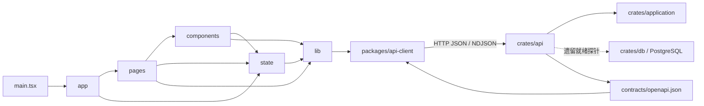
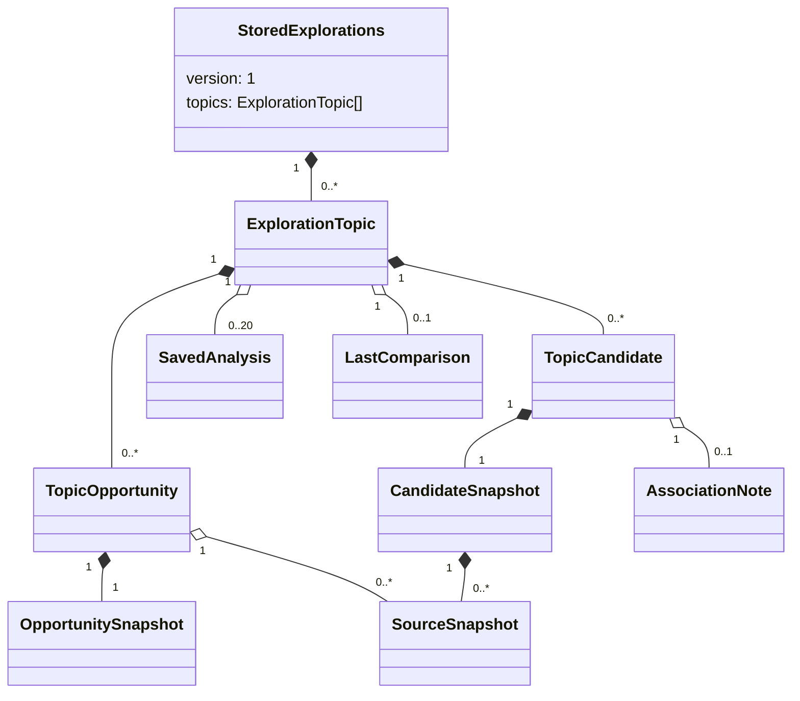
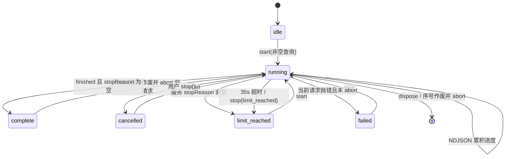
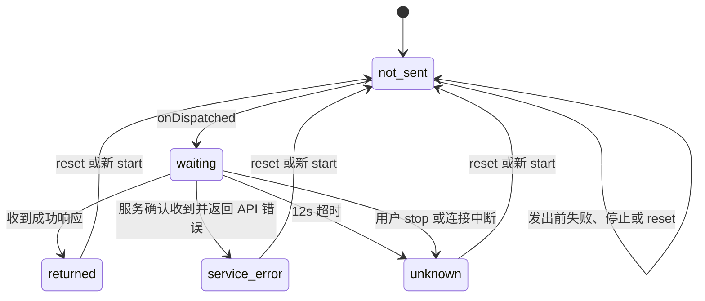

# 详细设计说明书

Last updated: 2026-10-29

本文描述当前中期版本的实际实现。接口约束以仓库中的 `contracts/openapi.json` 为准（说明见 [API 契约](../architecture/api-contracts.md)）；本文中的“私人”指用户在浏览器内创建或选择的内容，不表示系统已经实现账号级访问控制。

## 1. 模块划分

### 1.1 前端

| 目录 | 职责 | 主要依赖 |
| --- | --- | --- |
| `apps/web/src/app` | `App.tsx` 组合页面、全局提示和页头；`router.ts` 解析与生成 hash 路由；`theme.css` 提供应用样式 | `pages`、`components`、`state` |
| `apps/web/src/state` | `app-state.tsx` 持有当前主题、主题列表、比较托盘、演示选项和消息；`session-actions.ts` 把页面操作转换为当前主题的存储操作 | `lib/catalog.ts`、`lib/exploration-store.ts`、`lib/association-repair.ts` |
| `apps/web/src/pages` | 路由级视图：主页、探索、资料库、条目、比较、会话和演示指南 | `components`、`state`、`lib` |
| `apps/web/src/components` | 可复用交互与展示：页头、阶段条、实时发现、来源列表、私人记录、关联更正提示、AI 整理对话框等 | `state`、`lib`、Primer React |
| `apps/web/src/lib` | 领域模型、目录适配、匹配、比较、本地存储、发现运行器、AI 请求、批次校验和关联修复 | `@campus-agora/api-client`；不依赖页面 |

依赖方向为 `app/pages/components → state/lib → packages/api-client`。`lib` 中纯数据函数不反向依赖 React 页面；共享状态通过 `AppStateProvider` 暴露。入口 `main.tsx` 组合主题和状态 Provider（`apps/web/src/main.tsx:20-48`）。

### 1.2 服务端与客户端包

| 模块 | 职责 | 依赖方向 |
| --- | --- | --- |
| `crates/api` | Axum 路由、JSON/NDJSON 编解码、请求 ID、CORS、正文上限、HTTP 错误映射、健康与就绪探针、OpenAPI 导出 | `api → application`；另保留对 `db`、`domain` 的遗留依赖（`crates/api/Cargo.toml:9-19`） |
| `crates/application` | 无 Web 框架的发现与模拟整理用例；输入校验、白名单读取、结果组织 | `application → reqwest/scraper/tokio`；不依赖 `api` |
| `packages/api-client` | 从 OpenAPI 生成 TypeScript 类型；封装请求、错误、发现流和分析调用 | `web → api-client → HTTP API` |
| `contracts/openapi.json` | API 的版本化契约，也是生成 `packages/api-client/src/generated.ts` 的输入 | 由 API 导出，与生成类型保持一致 |

## 2. 前端路由表

路由为浏览器 hash，不依赖服务端重写。未知路径回到主页；缺少条目 ID 的 `#/item` 回到资料库（`apps/web/src/app/router.ts:17-52`）。

| Hash 路径 | `Route.name` | 参数 | 页面 |
| --- | --- | --- | --- |
| `#/` | `home` | 无 | `HomePage` |
| `#/explore[/<sessionId>]` | `explore` | 查询参数 `stage=explore\|discover\|process`，非法或缺省为 `explore`；可选 `q` | `ExplorePage` |
| `#/library` | `library` | 可选 `q`、`type` | `LibraryPage` |
| `#/item/<id>` | `item` | 路径参数 `id` | `ItemPage` |
| `#/compare` | `compare` | `ids` 为逗号分隔 ID；`p` 为可选视角 | `ComparePage` |
| `#/sessions` | `sessions` | 无 | `SessionsPage` |
| `#/demo` | `demo` | 无 | `DemoGuidePage` |

`routeHref` 对路径参数使用 `encodeURIComponent`，对查询参数使用 `URLSearchParams`；`go` 选择替换当前历史记录或写入 `window.location.hash`（`apps/web/src/app/router.ts:55-94`）。

## 3. 存储设计

### 3.1 localStorage 键

| 键 | 值 | 私人性与用途 |
| --- | --- | --- |
| `campus-agora:explorations:v1` | `{ version: 1, topics: ExplorationTopic[] }` JSON | 私人；完整探索主题、保存快照、理由、待问、决策和整理结果 |
| `campus-agora:last-topic:v1` | 主题 ID；空串表示“暂不保存” | 私人；恢复指针，不含主题正文（`apps/web/src/state/app-state.tsx:22-40`） |
| `campus-agora.color-mode.v1` | `day` 或 `night` | 非业务私人内容；界面偏好（`apps/web/src/main.tsx:8-17`） |

这些数据只在同源、同一浏览器中保存，不存在账号同步。历史 `campus-agora` 命名为兼容旧安装而保留。

### 3.2 私人主题模型

以下字段来自 `apps/web/src/lib/exploration-store.ts:49-148`。“私人”列表示字段是否由用户选择、编辑或在其主题中产生；候选和来源快照虽然源自公开资料，但保存组合仍属于该主题。

#### `ExplorationTopic`

| 字段 | 类型 | 可选 | 含义 | 私人 |
| --- | --- | --- | --- | --- |
| `id` | `string` | 否 | 浏览器生成的主题 UUID | 是 |
| `name` | `string` | 否 | 主题名称 | 是 |
| `question` | `string` | 否 | 用户问题 | 是 |
| `preferences` | `string` | 否 | 用户偏好 | 是 |
| `createdAt` / `updatedAt` | ISO 日期字符串 | 否 | 创建与最近业务修改时间 | 是 |
| `candidates` | `TopicCandidate[]` | 否 | 已保存候选 | 是 |
| `opportunities` | `TopicOpportunity[]` | 是 | 已保存入口型机会；旧 v1 记录可缺省 | 是 |
| `types` | `string[]` | 是 | 探索覆盖的机会类型；缺省或空表示全部 | 是 |
| `stage` | `explore\|discover\|process` | 是 | 当前流程阶段；切换阶段不更新 `updatedAt` | 是 |
| `lastComparison` | `LastComparison` | 是 | 最近保留的比较上下文 | 是 |
| `analyses` | `SavedAnalysis[]` | 是 | 本地保存的整理结果，最新在前，最多 20 条 | 是 |
| `pausedNote` | `string` | 是 | 暂停主题时的备注 | 是 |

#### `TopicCandidate`

| 字段 | 类型 | 可选 | 含义 | 私人 |
| --- | --- | --- | --- | --- |
| `candidate` | `CandidateSnapshot` | 否 | 保存时的公开候选和来源快照 | 组合是 |
| `reason` | `string` | 否 | 用户保存理由 | 是 |
| `questions` | `string[]` | 否 | 用户待问 | 是 |
| `savedAt` | ISO 日期字符串 | 否 | 首次保存时间 | 是 |
| `association` | `AssociationNote` | 是 | 公开对象拆分后，本地记录的迁移状态 | 是 |
| `decision` | `keep\|maybe\|exclude` | 是 | 当前主题内的筛选决定 | 是 |

#### `TopicOpportunity`

| 字段 | 类型 | 可选 | 含义 | 私人 |
| --- | --- | --- | --- | --- |
| `opportunity` | `OpportunitySnapshot` | 否 | `opportunityId/name/types/period/summary/entryUrl/checkedAt` 公开快照 | 组合是 |
| `reason` | `string` | 否 | 用户保存理由 | 是 |
| `questions` | `string[]` | 否 | 用户待问 | 是 |
| `savedAt` | ISO 日期字符串 | 否 | 首次保存时间 | 是 |
| `decision` | `keep\|maybe\|exclude` | 是 | 当前主题内决定 | 是 |
| `sources` | `SourceSnapshot[]` | 是 | 用户为该入口读过并保留的页面 | 组合是 |

#### `LastComparison`

| 字段 | 类型 | 可选 | 含义 | 私人 |
| --- | --- | --- | --- | --- |
| `question` | `string` | 否 | 比较时的问题 | 是 |
| `ids` | `string[]` | 否 | 比较对象 ID；存储校验要求每项非空，但不检查重复 | 是 |
| `perspective` | `string` | 否 | 比较视角 | 是 |
| `at` | ISO 日期字符串 | 否 | 保存比较的时间 | 是 |

#### `SavedAnalysis`

| 字段 | 类型 | 可选 | 含义 | 私人 |
| --- | --- | --- | --- | --- |
| `id` | `string` | 否 | 分析结果 ID | 是 |
| `question` / `createdAt` | `string` / ISO 日期字符串 | 否 | 问题和生成时间 | 是 |
| `providerLabel` / `simulated` | `string` / `boolean` | 否 | 服务标签和模拟标志 | 否 |
| `subjects` | `{id,name}[]` | 否 | 本次对象 | 组合是 |
| `evidence` | `{ref,subjectId,aspect,sourceTitle?,sourceUrl?}[]` | 否 | 所引公开依据的索引，不复制正文 | 组合是 |
| `sentFragmentIds` | `string[]` | 否 | 实际发送的私人片段 ID，不复制片段正文 | 是 |
| `sections` | `{kind,title,points[]}[]` | 否 | 整理分区；point 含 `text/evidenceRefs/privateFragmentIds` | 是 |
| `caveats` | `string[]` | 否 | 服务返回的限制说明 | 是 |

#### `AssociationNote`

| 字段 | 类型 | 可选 | 含义 | 私人 |
| --- | --- | --- | --- | --- |
| `correctionId` | `string` | 否 | 公开更正记录 ID | 否 |
| `status` | `relinked\|pending\|chosen` | 否 | 自动重连、待确认或已选择 | 是 |
| `previous` | `{candidateId,name,institution}` | 否 | 更正前身份 | 组合是 |
| `options` | `{candidateId,name,institution}[]` | 否 | 可选的新身份 | 否 |
| `updatedAt` | ISO 日期字符串 | 否 | 本地关联更新时间 | 是 |

### 3.3 校验、错误与兼容

- 读取先捕获 `getItem` 异常，再解析 JSON、检查 `version === 1`，最后递归校验字段、HTTP(S) URL、日期和各级 ID 唯一性（`apps/web/src/lib/exploration-store.ts:528-561`）。
- `lookupUrl` 必须与来源 URL 同源，且不得含用户名、密码或 token/auth/session/password/credential/api-key 类查询或 fragment 键（同文件 `207-220`）。
- 错误码为 `read_failed`、`write_failed`、`corrupted_data`、`unsupported_version`、`validation_failed`、`not_found`（同文件 `150-167`）。解析或校验失败不会覆盖原值。
- 每次修改先完整读取文档，在内存中修改并校验，然后只调用一次 `setItem(key, JSON.stringify(data))` 提交整份文档（同文件 `564-596`）；没有跨标签页锁或冲突合并。
- v1 的兼容策略是只增加可选字段：`opportunities/types/stage/lastComparison/analyses/pausedNote` 均可缺省；写回仍保持 `{version:1}`。未知顶层版本拒绝读取，不静默迁移。
- 候选刷新会合并公开来源但保留私人理由和待问；机会刷新只替换公开字段。来源以 `url + collectedAt + content + query + collection` 去重（同文件 `504-517,697-767`）。

## 4. 公开数据模型

### 4.1 `CatalogItem`

统一目录适配导师、实习和入口三类对象（`apps/web/src/lib/catalog.ts:22-53`）。

| 字段 | 类型 | 可选 | 含义 |
| --- | --- | --- | --- |
| `id` | `string` | 否 | 统一对象 ID |
| `kind` | `advisor\|internship\|entry` | 否 | 对象类别 |
| `types` | `OpportunityType[]` | 否 | 机会类型 |
| `name` / `org` / `summary` | `string` | 否 | 名称、机构、摘要 |
| `timing` / `period` | `OpportunityTiming` / `string` | 否 | 时效分类与原始时期文字 |
| `routeChips` | `{label,status}[]` | 否 | 参与途径及其证据状态 |
| `sourceCount` / `latestAt` | `number` / `string` | 否 | 来源数与最新采集或核查时间 |
| `entryUrl` | `string` | 否 | 原站入口 |
| `readableUrls` | `{url,title}[]` | 否 | 发现服务可直接读取的官方页面 |
| `origin` | `catalog\|saved-live\|saved-snapshot` | 否 | 公共目录或当前主题快照来源 |
| `candidate` / `entry` | `Advisor` / `Opportunity` | 是 | 类型专属原对象 |
| `searchText` | `string` | 否 | 本地匹配文本 |

目录优先于当前主题快照，查找不会读取其他主题（同文件 `209-230`）。

### 4.2 `CandidateSnapshot` 与 `SourceSnapshot`

| 模型 | 字段 | 类型 | 可选 | 含义 |
| --- | --- | --- | --- | --- |
| `CandidateSnapshot` | `candidateId/name/institution/research` | `string` | 否 | 身份和研究说明 |
|  | `sources` | `SourceSnapshot[]` | 否 | 保存的公开来源 |
|  | `type/title/description` | `string` | 是 | 外部候选的扩展分类、标题、描述 |
|  | `metadata` | `Record<string,string>` | 是 | 公开扩展元数据 |
| `SourceSnapshot` | `url/title/content/collectedAt` | `string` | 否 | 原页、标题、保留正文或摘要、采集时间 |
|  | `lookupUrl/accessNote` | `string` | 是 | 同源查找入口与访问说明 |
|  | `kind` | `snapshot\|live` | 是 | 预采集快照或本次实时读取 |
|  | `publishedAt/query` | `string` | 是 | 原页时间标签与查询 |
|  | `relevanceEvidence/unknowns` | `string[]` | 是 | 命中段落与未知事项 |
|  | `collection` | `SourceCollection` | 是 | 采集方法、内容类型、完整性、范围和批次 |

`SourceCollection` 的字段为 `method(browser_dom|web_read)`、`contentKind(summary|body)`、`readStatus(partial|complete)`、`scope`、`batchId`（`exploration-store.ts:1-35`）。`Advisor` 在 `CandidateSnapshot` 上增加必填 `approach/participation/unknowns` 和可选 `correctionNote`（`advisors.ts:15-21`）。

### 4.3 `CandidateProfile`

| 字段 | 类型 | 可选 | 含义 |
| --- | --- | --- | --- |
| `candidateId` | `string` | 否 | 对应候选 ID |
| `summary` / `themes` | `BoundClaim` / `BoundClaim[]` | 否 | 总结与研究主题；每项含 `text/urls` |
| `methods` | `BoundClaim` | 是 | 研究方法 |
| `routes` | `ParticipationRoute[]` | 否 | 参与路径 |
| `beyond` | `BeyondInfo` | 否 | 已知经历、资料缺口、公开路径和待问清单 |
| `preparation` | `PrepItem[]` | 否 | 准备项；含 `text/reason/origin/urls/resourceIds?` |
| `unknowns` | `BoundClaim[]` | 否 | 未确认事项 |
| `conflicts` | `{topic,versions}[]` | 否 | 冲突主题与各有来源的版本 |
| `perspectiveNotes` | `Partial<Record<research\|short-term\|graduate,BoundClaim>>` | 是 | 分视角补充说明 |

`ParticipationRoute` 含 `kind(undergrad|short-term|graduate)`、`label`、`status(evidenced|historical|unknown|not-stated)`、`statusNote`、`conditions` 和可选 `prerequisites`；条件另含 `level(required|preferred|suggested)`。`BoundClaim` 为 `{text,urls}`，准备项 `origin` 区分 `source` 与 `curated`（`apps/web/src/lib/profiles.ts:3-53`）。

### 4.4 预采集批次校验

`parseCollectedBatch` 只接受白名单字段和 `version:1`，拒绝私人记录；校验严格 ISO 时间、无凭据 HTTP(S) URL、同源 `lookupUrl`、`snapshot` 类型、批次 ID 一致、候选 ID 唯一且每个候选至少有一个来源（`apps/web/src/lib/collected-batch.ts:55-199,201-288`）。合并按完成时间和批次 ID 排序；同 ID 的姓名或机构冲突会报错，来源按五元组去重（同文件 `17-53`）。

## 5. 状态机

### 5.1 发现运行

每次 `start` 先递增序号并中止旧请求；进度和最终结果只有在序号仍匹配且信号未中止时才能发布。默认 35 秒前端等待上限，到期进入 `limit_reached`；服务返回 `stopReason` 也进入该状态（`apps/web/src/lib/discovery-run.ts:20-95`）。

### 5.2 AI 发送

`createAnalysisRun` 默认等待 12 秒。`onDispatched` 被调用前停止可证明 `not_sent`；调用后超时、断连或用户停止只能标为 `unknown`，因为 abort 不能撤回已交给网络的请求。仅带 HTTP 状态和 request ID 的 `CampusAgoraApiError` 归为 `service_error`（`apps/web/src/lib/analysis.ts:191-301`）。

## 6. 关键算法

### 6.1 文本匹配

`matchTokens` 提取长度至少 2 的小写 ASCII 词和连续中文的二元组，丢弃含常见虚词字符的二元组；`matchedTerms` 做子串匹配，`matchScore` 给 ASCII 命中 2 分、中文命中 1 分（`apps/web/src/lib/text-match.ts:1-44`）。它没有分词、语义消歧或字段权重；中文二元组和子串命中会把仅共享常见片段的对象排得过高，当前目录搜索存在过度匹配。

### 6.2 比较行构建

`buildCompareRows` 先要求对象同类，再按导师、实习、入口选择构建器（`apps/web/src/lib/compare.ts:392-411`）。导师 profile 的每个 claim 显式绑定 URL，比较单元只取候选中该 URL 最新的快照；无 profile 的候选退回其保留来源，不评分，缺失事实明确标未知。实习复用证据单元。入口每一行都只构造同一个“原站入口”来源，条件、支持等单元没有逐字段来源绑定；因此引用只能证明入口地址存在，不能证明该单元文字来自入口页的哪处（同文件 `350-389`）。

### 6.3 误合并修复

公开更正文件把一个旧候选拆成至少两个对象，并要求旧记录的每个来源 URL 恰好分配一次；重复 ID、跨对象重复来源、未知来源或漏分都会拒绝（`apps/web/src/lib/association-repair.ts:61-197`）。本地修复只看已存来源 URL：全部来源唯一命中一个新对象且不与主题内记录冲突时自动 `relink`；否则标记 `pending` 让用户选择。私人理由、待问和来源不参与匹配，也不被合并或重写（同文件 `224-274`；`exploration-store.ts:819-937`）。

### 6.4 模拟整理

`organize` 固定输出“资料差异、与你的问题相关、你选择发送的记录、仍需确认”分区。差异按 `aspect` 分组后并列各对象首条证据；问题和私人片段通过词项重合选择最多三条或最佳一条依据；未知项按 `unknowns/未知/确认` 标签收集（`crates/application/src/analysis.rs:369-633`）。它不调用模型，不推理证据关系，也不判断优劣；本质只是按维度并列文本、截取片段和计算关键词重合。

## 7. 接口设计

统一错误体为 `{code,message,requestId,details?}`；正文默认上限 1 MiB，超限为 HTTP 413 / `request_body_too_large`（`crates/api/src/lib.rs:432-474`）。

### 7.1 `POST /api/v1/discoveries`

- 请求：`{query:string}`，去空白后 1–200 字，不得含控制字符；可以是公开关键词或白名单内完整 HTTP(S) URL。
- 普通响应为 JSON；`Accept: application/x-ndjson` 时返回累积 `DiscoveryResponse`，首帧 `finished=false`，结束帧 `finished=true`。断开会取消服务端 worker（`crates/api/src/discovery.rs:82-149`）。
- 响应字段：`query/provider/scope/status/collectedAt/sources/warnings/finished/stopReason/startedReads/completedReads/limits`。source 含 `url/title/institution/content/searchSnippet/relevanceEvidence/collectedAt/publishedAt?/unknowns`。
- 限制：30 秒、最多 5 个结果、6 次读取、48 次 HTTP 请求、每页 1,000,000 字节，抽取正文最多 16,000 字；同时最多 2 个发现请求（`crates/application/src/discovery.rs:15-19,619-620`；`crates/api/src/discovery.rs:23`）。
- 错误：422 / `validation_failed`；429 / `discovery_busy`；413 / `request_body_too_large`。上游读取问题通常进入 `warnings` 与 `complete|partial|failed` 结果，而不是改成 HTTP 错误。

### 7.2 `POST /api/v1/analyses`

- 请求字段：`operation(compare|shortlist)`、`question`、`subjects`、`evidence`、`selectedPrivateFragments`、可选 `simulation`。
- 上限：问题 1–300 字；对象 1–8 个且 ID 唯一，`compare` 至少 2 个；证据最多 60 条，ref 唯一，正文 1–800 字；私人片段最多 10 条，ID 1–60 字、正文 1–500 字；关联 ID 必须指向请求对象；来源仅接受最长 500 字的 HTTPS URL；模拟延迟 0–5000 ms（`crates/application/src/analysis.rs:165-360`）。
- `simulation.outcome` 为 `ok|error|hang`；`hang` 固定睡眠 20 秒，用于前端不确定状态演示。
- 错误：422 / `validation_failed`，`details.fields` 给出字段问题；503 / `analysis_simulated_failure`；413 / `request_body_too_large`。

### 7.3 探针与元数据

- `GET /healthz`：进程存活即返回文本 `ok`。
- `GET /readyz`：执行 PostgreSQL `select 1`，返回 `status:ready|unready` 和 `checks.postgres:ok|unavailable`；失败为 503（`crates/api/src/lib.rs:374-389,494-506`）。
- `GET /api/v1/meta`：返回 `appName/version/capabilities`。

上述 schema、状态码和媒体类型见仓库中的 `contracts/openapi.json`。

## 8. 安全与隐私设计落点

- 发现服务只允许教育/研究域后缀、逐项核对的个人主页和少量机构招聘路径；搜索只访问固定 DuckDuckGo HTML 主机。URL 禁止凭据、自定义端口和敏感查询键（`crates/application/src/discovery.rs:20-50,767-797`）。
- SSRF 防护在每次请求及最多四次手动重定向时重验白名单；禁用代理和自动重定向；DNS 结果必须全部为公网地址并固定解析地址；拒绝本地、私网、链路本地、文档网段、基准测试网段和非全局 IPv6（同文件 `625-743,799-827`）。
- 读取只接受 HTML/XHTML，单页限 1 MB，连接、请求和整轮均有超时。远端正文被视为证据文本，不执行其中指令。
- 私人理由和待问默认只在 localStorage。前端逐项列出可发送片段，仅把用户勾选且属于当前主题的片段写入分析请求，最多 10 条（`apps/web/src/lib/analysis.ts:39-77,139-167`）。
- 分析 API 的结构化日志只记 request ID 和三类计数，不记录问题、证据或私人正文；响应声明 `retention:none`，服务为无状态进程内模拟（`crates/api/src/analysis.rs:57-64`；`crates/application/src/analysis.rs:394-432`）。
- API 配置 CORS 白名单并为每个响应附 `x-request-id`；这不等同于认证或授权。当前个人存储依赖浏览器同源边界。

## 9. 遗留与技术债

1. `crates/db/migrations/20260706000000_init.sql` 仍创建 `users/posts/post_revisions/audit_events` 社区内容表；当前探索流程不读写这些表。
2. `/readyz` 仍把 PostgreSQL 作为唯一就绪条件，尽管发现和模拟整理本身无持久化依赖；未配置或不可达时整个服务报告 unready。
3. `apps/desktop` 仍是 Tauri 壳，加载同一 Web 产物；CI 仍有独立 desktop job（`.github/workflows/ci.yml:47-54`），而当前产品主路径是浏览器 SPA。
4. `/api/v1/meta` 仍暴露 `authMockEnabled/desktopEnabled/aiArchiveEnabled/attachmentsEnabled` 四个旧能力标志，默认值为 `true/true/false/false`；这些标志不描述当前“本地主题 + 模拟整理”的核心能力（`crates/api/src/lib.rs:34-65,136-151`）。
5. localStorage 键和包名仍使用历史 `campus-agora`，改名会破坏已有浏览器数据和 workspace 引用，因此尚未切换。
6. `crates/api` 仍直接依赖 `campus_agora_db` 和 `campus_agora_domain`，`crates/application` 也保留 `domain` 依赖；当前两项用例未形成完全最小化的依赖边界。

## 10. 局限

- localStorage 是整文档最后写入者获胜；没有跨标签页锁、事务日志、加密、配额恢复、导入导出或云端备份。浏览器清理站点数据会删除私人记录。
- v1 仅支持加法式可选字段；没有从未来版本降级或迁移的实现。字段损坏会让整份主题文档拒绝读取。
- 实时关键词搜索经常被上游验证页阻断；当前实现只能如实返回失败/部分结果，已知官方 URL 的直接读取更可靠。它不覆盖登录页、PDF、需 JavaScript 页面或全网内容。
- 目录搜索采用中文二元组，存在过度匹配；比较不评分，入口比较行只有入口 URL 级来源绑定。
- 模拟 AI 只并列证据并匹配关键词，不提供模型推理。其结果不能作为事实核验或推荐。
- 当前顾问 profile 中有 7 份由 AI 子代理撰写且尚无人审；条目和 profile 的内容质量不能由类型校验保证（`docs/product/requirements-handoff.md:243-245`）。
- 尚无中国科大学生用户研究或学生试用；走查由构建者自行完成，截图未归档。因此交互可用性和真实学习效果没有独立证据（`docs/project/feasibility.md:116-120`）。
- 个人内容“只在确认后发送”由前端选择流程和同源部署约束实现；系统没有账号、服务端权限模型或恶意同源脚本隔离。
