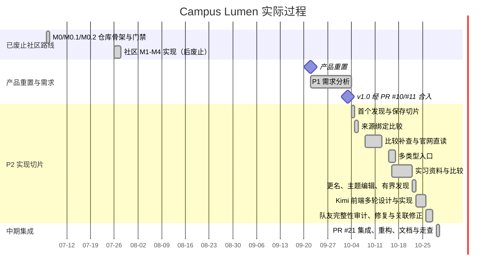

# 项目计划与进度（中期）

Last updated: 2026-10-29

本文记录中期检查前的计划、实际进度、分工和风险。需求依据见[需求分析 v1.0](../product/requirements-handoff.md)，验收口径见[中期验收标准](acceptance.md)，执行结果见[测试报告](test-report.md)。

## 1. 10-29 开工前的进度盘点

### 1.1 阶段

| 阶段 | 10-29 开工前状态 | 10-29 实际状态 |
| --- | --- | --- |
| P1 需求与信息供给验证 | 需求分析 v1.0 已由 PR #10、#11 合入；学生收益与长期供给未验证 | 基线不变；仍无学生试用或长期供给结论 |
| P2 产品原型与技术取舍 | 主要切片已实现并经开发者走查；完整走查（G5）未做 | 功能并入 PR #21；完成开发者走查，不等于独立验收 |
| P3 中期 / 比赛 demo | 进行中 | 统一流程、模拟 AI、文档和测试报告已进入 PR #21；PR 尚未合并 |
| P4、P5 | 条件性，未启动 | 未启动 |

### 1.2 分支与 PR

| 分支 / PR | 作者 | 内容 | 10-29 开工前状态 | 10-29 结果 |
| --- | --- | --- | --- | --- |
| main `7fae667` | — | 截至 PR #17 的多类型入口、实习比较、导师发现与比较、官网直读、多主题保存 | 主线 | 作为集成基线之一 |
| #18 `feat/topic-edit-and-bounded-discovery` | 114August514 | 更名、主题条件编辑、流式返回、中止与上限 | 开着 | 已包含在 PR #21；#18 本身仍开着 |
| `codex/demo-high-priority` | jasonxu-cell | 新候选进入比较、实习数据纠错、招聘站白名单 | 已推送，无 PR | 经 `968f691` 并入集成历史 |
| #20 `feat/association-repair` | jasonxu-cell | 误合并修正与私人记录重新关联 / 待确认 | 开着，目标为上一分支 | 经 `8f618ff` 并入 PR #21；#20 本身仍开着 |
| #19 `docs/kimi-frontend-design-review` | 114August514 | Kimi 前端预设计文档 | 开着 | 未合并；仅作设计讨论材料 |
| `wip/kimi-frontend-2026-10-25` | August / Kimi | 10-23 至 10-25 的品牌、主题、导航、比较、会话与工作台 | 本地未提交内容待保存 | 以 `6fffbd0` 保存并合入；工作台随后在 10-29 重构中移除 |
| #21 `feat/midterm-demo` | 114August514 | 集成上述功能、统一前端、模拟整理接口、测试与软件工程文档 | 尚未创建 | 10-29 创建，当前 OPEN |

### 1.3 能力对照

| 能力 | 10-29 开工前 | 10-29 实际 |
| --- | --- | --- |
| 已有资料检索 | 7 位导师、3 个实习、26 条入口 | 保留并接入统一资料库和详情页 |
| 联网查找与正文读取 | 关键词搜索常遇验证页；官网直读较稳定 | 保留失败状态；开发者走查中直读江祖铭主页和 MPI 实习页成功 |
| 来源与时间显示 | 已实现 | 保留并统一展示 |
| 多主题保存、私人记录隔离 | 同源浏览器已实现 | 保留；仍受 origin 约束 |
| 比较 | 固定导师 / 实习整理；任意已发现候选比较在队友分支 | 按机会类型统一入口，补查可回填对应格子 |
| 主题条件编辑、可中止且有上限的发现 | #18 已实现 | 已集成 |
| 误合并修正 | #20 已实现机制，更正文件为空 | 已集成并接入处理阶段 |
| 准备重点、知情者 / 联系入口 | 未实现 | 导师档案提供有来源的准备建议、公开途径和缺口；没有经历材料时不编造 |
| 外部 AI 选择发送与发送状态 | 未实现 | 模拟服务已实现；不宣称真实模型调用 |
| 深链接 / 返回键 | 未实现 | hash 路由、返回键和页面拆包已实现 |

### 1.4 已知问题与 10-29 处理

- **数据**：队友审计发现 MSRA 三个月 / 六个月及若干无来源细节冲突；10-27 删除无依据断言并保留仍无法确认的岗位身份差异。
- **文档**：10-29 修正七类跨分支陈旧或矛盾内容：C1 其他机会类型范围，C2 外部 AI 口径，C3 需求 §8.1 状态，C4 需求 §8.4 状态，C5 隐私数据清单，C6 发现运行上限，C7 支持环境。
- **工程**：开工前 `App.tsx` 约 1177 行、主包约 886 kB（gzip 221 kB）；10-29 拆分路由和页面后主包 gzip 156 kB。后端 domain / db 仍主要是边界，唯一数据库迁移仍是旧社区表结构。

### 1.5 实际时间线

日期依据 `git log --all`、PR 清单和 `done.md`；长条表示该阶段实际有记录的跨度，不表示每天连续投入。

## 2. 整合计划

1. 将 Kimi 本地前端保存为 `wip/kimi-frontend-2026-10-25`。
2. 以包含 #18、`codex/demo-high-priority` 和 #20 的 `origin/feat/association-repair` 为集成基础。
3. 合入 Kimi 分支；数据更正和主题隔离采用队友版本，保留可复用界面工作。
4. 按[前端设计 v1.1](../product/frontend-design.md)重构并增加模拟整理接口。
5. 以 PR #21 交付，不直接替用户合并 main。

上述五步已在 10-29 完成；PR #21 是否合并仍由仓库维护者决定。

### 2.1 中期交付 WBS

```mermaid
flowchart TD
    A[中期交付：PR #21]
    A --> R[需求：已完成基线]
    R --> R1[需求分析 v1.0：已合入 #10/#11]
    R --> R2[需求规格与追踪：已更新]
    R --> R3[真实用户验证：未完成]
    A --> D[设计：部分完成]
    D --> D1[任务/信息结构与前端设计：已完成]
    D --> D2[概要/详细设计文档：已形成]
    D --> D3[人类设计评审：未完成]
    A --> I[实现：中期范围已完成]
    I --> IW[Web：统一流程/路由/比较/主题]
    I --> IA[API：发现 + 模拟 analyses]
    I --> ID[数据：来源绑定档案/静态批次]
    I --> IL[数据库：旧社区迁移仍遗留]
    A --> T[测试：开发者验证完成]
    T --> T1[自动化与 CI：PR #21 已记录通过]
    T --> T2[浏览器走查：已做主要路径]
    T --> T3[独立验收/完整读屏：未完成]
    A --> DOC[文档：中期集已完成]
    DOC --> DOC1[项目/产品/工程文档同步]
    DOC --> DOC2[过程回顾与评审记录]
    A --> DEL[交付：进行中]
    DEL --> DEL1[PR #21：OPEN]
    DEL --> DEL2[合并与课堂演示：待完成]
```

## 3. 三天计划（2026-10-29 至 10-31）

| 日期 | 原计划 | 计划产出 | 实际 |
| --- | --- | --- | --- |
| 10-29 | 验收标准、前端设计、分支整合、仓库与软件工程文档、模拟接口、前端骨架 | 文档集、`feat/midterm-demo` | 原三天主要范围当天完成并创建 PR #21；统一前端不止骨架，已完成主要页面和走查 |
| 10-30 | 探索、详情、比较、AI 整理、资源、主题、演示路线、测试 | 可走查 demo | 预留复查和修复；截至本文日期尚未发生 |
| 10-31 | 1280 / 390 / 暗色 / 键盘 / 实时读取走查、修复、报告、手册、PR 与 CI | 测试报告、用户手册、PR | 主要走查、报告、手册和 PR 已提前至 10-29；完整读屏与独立验收仍未完成 |

## 4. 风险登记册

概率和影响是依据已发生事实及当前结构作出的项目判断；没有统计模型的项目判断标为【推断】。

| ID | 风险 | 概率 / 理由 | 影响 / 理由 | 负责人 | 缓解措施 | 状态 |
| --- | --- | --- | --- | --- | --- | --- |
| R01 | 关键词发现被验证页拦截 | 高：10-04、10-08、10-22 均有实际失败 | 高：实时发现主路径可能无结果 | August | 演示优先官网直读；保留失败与有限回退，不用固定数据冒充实时结果 | 已发生，未消除 |
| R02 | 7 份 AI 撰写导师档案未经人类逐条内容评审 | 高：当前无该评审记录 | 高：可能传播错配、过时或过度解释 | August | 逐条核对来源、时间、推断和“未知”，由非作者签字 | 待处理 |
| R03 | 构建与验证由同一代理 / 协调链完成 | 高：日志多次记录协调者复核自己或 Kimi 输出 | 中：自动化通过仍可能遗漏共同盲点 | August | 安排队友或教师按验收脚本独立走查，记录差异 | 待处理 |
| R04 | 没有 USTC 一手用户研究或学生试用 | 高：需求稿和测试报告明确没有 | 高：无法证明实际收益、可理解性和使用意愿 | August | 中期后至少请 1 名非作者学生完成对照任务并记录 | 未验证 |
| R05 | localStorage 随 origin / 浏览器变化丢失 | 中：实现绑定同源，换端口即不同存储 | 中：演示主题和私人记录看似消失 | August | 固定 `127.0.0.1:5173`；演示用合成主题；不承诺同步 | 已知限制 |
| R06 | 已废止社区代码 / 数据库迁移仍进入 CI 和维护面 | 高：旧 crates、迁移和历史功能仍在仓库 | 中：增加检查耗时并混淆当前架构 | August | 中期后列出当前产品真正依赖，决定删除或隔离；删除前保留历史标签 | 待处理 |
| R07 | 单一主要维护者 / 公交因子 | 高【推断】：88/100 个历史提交使用 August 两个作者名 | 高【推断】：需求、集成和发布知识集中 | August | 队友完成一次从文档启动、修改、验收和回滚演练；减少隐性本地状态 | 待处理 |
| R08 | 演示网络或 API 不可用 | 中【推断】：外部站点和本地 API 都是运行依赖 | 高：实时项无法展示 | August | 演示前健康检查；失败时如实展示，其余固定资料流程继续 | 待演练 |
| R09 | 私人内容误发给外部 AI | 低：中期只接模拟服务，默认不选私人项 | 高：违反隐私边界 | August | 维持逐项选择、发送前确认和五态反馈；真实模型接入前复审 | 当前受控 |

## 5. 分工

仓库只有两名团队成员。AI 代理是 August 使用的开发工具，不计为成员，也不承担课程项目责任。

`git log --all --format=%an` 的作者名计数为：`August` 81、`114August514` 7、`jasonxu-cell` 12；前两个名字均属 August，因此按人员合计为 August 88、jasonxu-cell 12。计数包含已废止社区路线、合并 / 文档提交和 AI 辅助提交，不能直接等同工作量。

| 人员 / 工具 | 身份 | 责任 | 有记录的具体贡献 |
| --- | --- | --- | --- |
| August（`August` / `114August514`，88 commits） | 成员 | 需求分析、产品决策、总体协调和交付；通过 AI 编码代理实施 | 产品重置与 P1 文档（PR #10）；发现、保存、比较及后续切片（PR #12–#14、#17、#18）；Campus Lumen 更名；10-29 集成、统一前端、模拟 API、文档和 PR #21 |
| jasonxu-cell（12 commits） | 成员 | 按已有记录完成审计和高优先级修复 | PR #11 补充发现 / 隔离 / AI 边界；PR #16 多类型入口；10-26 demo 完整性审计；10-27 `968f691` 高优先级修复和 `8f618ff` 误关联修复（PR #20） |
| Codex | August 使用的 AI 工具，非成员 | 编码与审查辅助 | PR #1–#3 标题记录其用于 M0/M0.1/M0.2；后续具体归属只在日志明确时引用，不按 Git 作者名另计 |
| Claude | August 使用的 AI 工具，非成员 | 需求 / 代码 / 文档协调、实现和验证辅助 | PR #10 提交记录含 Claude Code；PR #16 提交记录含 Claude；10-29 计划中记录由 Claude 协调前端、接口、文档和验收 |
| Kimi | August 使用的 AI 工具，非成员 | 10-23 至 10-25 前端专项设计与实现 | 工作台、PR #15 视觉基线接续、亮暗主题、导航、会话列表、并排比较和多轮页面诊断；成果以 `6fffbd0` 保存，10-29 大部分页面结构被统一前端重构替换，工作台移除 |

## 6. 执行后的状态（2026-10-29）

集成 PR 为 [#21](https://github.com/114August514/campus-lumen/pull/21)，当前状态为 OPEN。原计划三天的主要实现和文档工作在 10-29 完成，不能据此把尚未发生的独立验收或用户研究写成完成。

| 能力 | 状态 |
| --- | --- |
| 所有类型统一“探索 → 发现 → 处理” | 已实现 |
| 联网查找、官网直读、中止和迟到结果隔离 | 已实现；关键词索引仍不可靠 |
| 导师 / 实习 / 通用条目的来源绑定比较 | 已实现 |
| 准备重点、公开途径和缺口表达 | 已实现导师深度示例；其他类型不宣称同等资料深度 |
| 外部 AI 选择发送与状态 | 模拟服务已实现；真实模型后置 |
| 误合并修正 | #20 机制已集成 |
| 深链接、返回键、按页面拆包 | 已实现 |
| 软件工程文档 | 中期文档集已形成；过程回顾与评审缺口如实记录 |

剩余工作：

- 由维护者决定 PR #21 的合并；
- 完整键盘 / 读屏检查和非构建者独立验收；
- 人类复核 7 份 AI 撰写导师档案；
- 真实学生试用和 USTC 一手研究；
- 真实模型接入与旧社区代码处置，均列入中期后工作。
