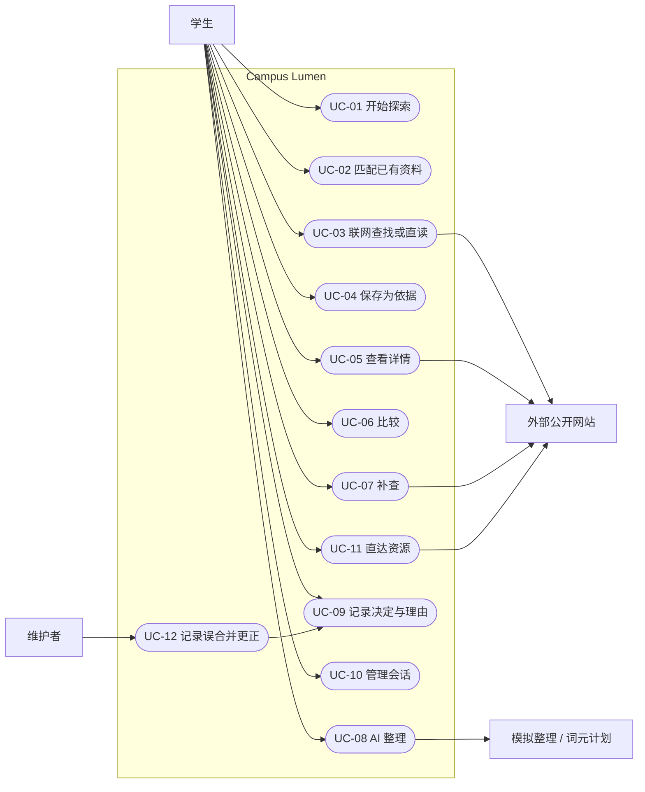

# 需求规格说明

Last updated: 2026-10-31

状态：中期 SRS 视图。需求理由、证据和不确定性见[需求分析 v1.0](../product/requirements-handoff.md)；本文只给出可追溯、可测的规格，不重复长篇论证。验收编号来自[中期验收标准](acceptance.md)。

## 1. 范围与用户

Campus Lumen 服务大学生个人，帮助其跨机构探索机会与支持、查看来源、比较候选、形成私人判断并接续会话。所有机会类型共用“探索 → 发现 → 处理”流程；选导师是内容最深的示例，其他类型使用已有整理入口。系统不代办申请、不自动联系、不做公开评价，也不提供跨设备同步。AI 整理默认使用模拟服务，服务端配置后可由用户按次改选中国科大词元计划。

主要用户状态：兴趣探索者、有明确对象的补查者、比较选择者、需要了解与准备者、恢复既有探索者、只需资源／办理入口者。对应 T1–T6 见[任务设计](../product/advisor-task-design.md)。

### 1.1 用户画像

以下均为**设计用画像，来自需求分析中的使用状态与 AIDS 案例，不是用户调研结果**。画像只用于检查任务覆盖，不代表已验证的人群比例或固定用户分类。

| 画像 | 当前情境 | 主要任务 | 对应需求 |
| --- | --- | --- | --- |
| 想参加短期科研的本科生 | 对 AI／软件方向有大致兴趣，希望了解校内外短期科研，但尚不清楚具体导师、项目和资格 | 从问题开始探索，区分导师的不同参与途径，比较条件，补查未知并保存依据 | N01–N06、N08 |
| 准备申请研究生的高年级学生 | 已有研究方向和候选，希望核对具体研究、指导相关线索、招收状态与准备重点 | 查看详情与原文，比较候选，记录私人理由和待问事项，分主题接续 | N03–N06、N09、N11 |
| 只想找资源入口的同学 | 已有算力、文献、活动或规则方面的明确需求，不准备完成完整探索流程 | 按用途查找资源，核对权限／费用／时效并直达官方入口 | N07–N08 |

## 2. 系统边界

- Web：React/Primer 单页应用，hash 路由，会话与私人内容保存在当前浏览器。
- API：无状态 Axum 服务，提供健康／元数据、公开页面发现，以及默认模拟、可选词元计划的整理接口。
- 外部：公开搜索和允许范围内的网页；仅当用户按次选择且服务端已配置 Key 时调用词元计划。
- 事实来源：公开资料、已审查批次和实时正文；模拟或合成内容必须显著标识，模型输出不得冒充已核验事实。

### 2.1 用例图

### 2.2 用例说明

| 用例 | 前置条件 | 主流程 | 异常流程 | 对应 FR |
| --- | --- | --- | --- | --- |
| UC-01 开始探索 | Web 可用；无需已有会话 | 1. 学生输入问题；2. 可选机会类型；3. 系统建立临时探索；4. 进入发现 | 问题为空时提示补充；修改条件不丢已存内容，也不自动联网 | FR-01、FR-16 |
| UC-02 匹配已有资料 | 已有问题；资料库已加载 | 1. 系统按问题匹配；2. 标明“已有资料”和采集时间；3. 学生筛选类型；4. 打开候选或继续联网 | 无匹配时显示空状态和下一步；匹配过宽时允许改问题／类型 | FR-02、FR-10、FR-16 |
| UC-03 联网查找或直读 | 学生明确发起；有查询词或公开 URL | 1. 确认查询／URL；2. 请求外部公开网站；3. 显示进度和范围；4. 返回正文节选、来源与取得时间 | 区分无结果、验证页、读取失败、中止和上限；保留已到结果，拒绝迟到写入 | FR-02、FR-03 |
| UC-04 保存为依据 | 已取得可核对正文；存在候选或当前探索 | 1. 学生检查正文；2. 选择关联对象；3. 确认保存；4. 系统记录来源、时间和与问题的联系 | 关联不明时标记待确认；重复来源不重复新增；冲突并列保留 | FR-02、FR-07、FR-10 |
| UC-05 查看详情 | 已选择一个对象 | 1. 展示通用详情骨架；2. 分开人物、工作和参与途径；3. 显示条件层级、状态与按需准备重点；4. 学生回到原文 | 缺失节不显示；未知保持未知；失效来源保留历史标记 | FR-04、FR-05、FR-08、FR-10、FR-12 |
| UC-06 比较 | 已选择 2–4 个同类对象 | 1. 选择当前问题／视角；2. 系统按同类维度并列；3. 显示差异、来源和未知；4. 学生形成取舍 | 混入不同类型时拒绝比较；缺资料显示依据不足，不记零分 | FR-05、FR-06、FR-17 |
| UC-07 补查 | 详情或比较中存在未知项 | 1. 从未知项发起；2. 预填问题与候选；3. 执行查找／直读；4. 学生确认依据；5. 回填原位置 | 失败时保留未知和原比较；来源冲突时并列待核 | FR-02、FR-06、FR-07 |
| UC-08 AI 整理 | 当前主题已有公开依据；模拟服务可用，词元计划是否可选由服务端配置决定 | 1. 查看接收服务与发送内容；2. 按次选择模拟服务或词元计划；3. 可逐条选择私人片段；4. 确认发送并查看等待／返回状态；5. 主动选择是否保存 | 未配置时词元计划不可选；取消发送保持未发送；超时／断连显示送达不明；服务失败不影响原依据 | FR-14、FR-15 |
| UC-09 记录决定与理由 | 当前会话中已有对象 | 1. 选择保留／待定／排除／未决定；2. 填写私人理由或待问；3. 保存到当前会话；4. 按决定筛选 | 存储失败时不宣称已保存；关联待确认、冲突和未读正文集中提示 | FR-11、FR-17 |
| UC-10 管理会话 | 浏览器存储可用 | 1. 新建或切换会话；2. 编辑问题／偏好；3. 恢复对象、依据与理由；4. 删除指定会话 | 无旧会话时从临时探索开始；删除一会话不得影响其他会话或公共资料 | FR-01、FR-11 |
| UC-11 直达资源 | 资料库可用 | 1. 输入用途／名称／条件；2. 查看权限、费用性质和时效；3. 打开详情；4. 直达原站 | 无适用结果时显示替代查找入口；外站不可用时保留来源信息 | FR-09、FR-10 |
| UC-12 记录误合并更正 | 维护者发现公共对象或途径误合并 | 1. 记录拆分及正确关联；2. 系统重联可确定记录；3. 标记不确定记录；4. 学生选择不确定归属；5. 保留私人理由和原依据 | 无法确定时不得自动复制或丢弃私人内容；更正失败时保留原记录并标待核 | FR-13 |

## 3. 功能需求

| 编号 | 可测要求 | 来源 | 用户任务 | 验收 |
| --- | --- | --- | --- | --- |
| FR-01 | 用户无需先建会话即可按问题和可选类型开始；修改条件不丢已存记录，也不自动联网 | N01 | T1 | F01、F12 |
| FR-02 | 系统同时支持已有资料匹配和显式发起的外部搜索／官网直读，展示来源、取得时间、相关节选与范围 | N02 | T1、T2 | F01–F04 |
| FR-03 | 用户可中止发现；系统保留已到结果，区分完成、中止、上限、失败，丢弃中止后的迟到写入 | N02 | T1、T2 | F03、F04 |
| FR-04 | 对象详情关联对象、工作、参与途径、条件、资源与原文；导师不同途径分开 | N03 | T2、T4 | F05 |
| FR-05 | 条件必须区分硬要求、优先、建议；外校／海外前提按途径表达，未知不得推断 | N04 | T2、T3 | F05、F06 |
| FR-06 | 用户可按当前问题比较 2–4 个同类对象；不同类型不可混比，缺资料显示依据不足而非零分 | N05 | T3 | F06、F07 |
| FR-07 | 用户可从比较未知项发起补查，并将确认后的依据回填对应对象和问题 | N02、N05 | T2、T3 | F07 |
| FR-08 | 系统按需展示准备重点、理由、可跳过项及相关资源，不强制成长任务 | N06 | T4 | F10 |
| FR-09 | 资料库按用途、名称、条件和注意事项搜索，显示权限／费用性质／入口，允许不建会话直达原站 | N07 | T6 | F10 |
| FR-10 | 当前、历史、未知状态分开；历史材料不得显示为当前开放 | N08 | T1–T6 | F05、F08 |
| FR-11 | 用户可创建多个会话，分别保存对象、依据、决定、私人理由和待问；同浏览器重开恢复且会话隔离 | N09 | T5 | F11、F12、F17、F19 |
| FR-12 | 有经历资料时显示角色、时期、来源；没有时显示缺口、公开了解路径和待问，不评价人格或品质 | N11 | T4 | F09 |
| FR-13 | 系统支持纠正误合并；可确定记录重联，不确定记录由用户选择，私人内容和原依据不丢失 | N12 | T5 | F13、F19 |
| FR-14 | AI 整理发送前展示问题、公开依据、接收服务和个人片段；个人片段默认不选，只发送用户逐条选择内容 | 隐私要求 | T3–T5 | M2、F14 |
| FR-15 | 整理服务默认模拟；用户可按次选择已配置的词元计划。两者均显示未发送、等待、返回、送达不明／停止等待；超时或取消不宣称撤回，重试不扩大内容，结果显示实际平台／模型或模拟标签 | 隐私要求 | T3–T5 | M2、F15、F16 |
| FR-16 | 导师及至少另外两种类型使用同一套探索、发现、处理页面和组件；仅详情／比较维度按类型变化 | 2026-10-15/29 范围决定 | T1–T6 | M1、F18 |
| FR-17 | 处理区支持保留、待定、排除、未决定，并集中提示关联待确认、冲突和未读正文 | N05、N09、N12 | T3、T5 | F19 |

### 3.1 用户故事与验收条件

| 用户故事 | 验收条件 | 映射 |
| --- | --- | --- |
| 作为目标尚模糊的学生，我想不先建会话就开始探索，以便先看到可继续了解的方向。 | 首页输入问题后能看到带“已有资料”和采集时间的结果；改条件不丢记录且不自动查询。 | FR-01、FR-02；UC-01、UC-02；F01、F12 |
| 作为有明确对象的学生，我想读取公开页面并保存正文依据，以便判断信息来自哪里。 | 至少一次官网直读取得正文、节选、取得时间和问题联系，确认后保存到候选。 | FR-02、FR-03；UC-03、UC-04；F02–F04 |
| 作为短期科研探索者，我想区分同一导师的参与途径和条件层级，以便不把研究方向误当成当前招收。 | 详情分开途径，条件分硬要求／优先／建议，历史和未知不显示为开放。 | FR-04、FR-05、FR-10；UC-05；F05、F08 |
| 作为正在取舍的学生，我想比较同类候选并补查未知，以便形成有来源的选择理由。 | 2–4 个同类对象可比较；未知不记零分；补查依据回填到原候选和问题。 | FR-06、FR-07；UC-06、UC-07；F06、F07 |
| 作为希望了解实际情况的学生，我想看到经历证据或明确的缺口与待问，以便不把自述当作指导质量证明。 | 有资料时显示角色、时期和来源；无资料时显示缺口、公开了解路径和待问，不评价品质。 | FR-12；UC-05；F09 |
| 作为只需办事入口的学生，我想按用途找到资源并直达原站，以便不完成整套探索也能结束任务。 | 资料库能按用途和注意事项搜索，显示权限／费用性质／时效，并可打开官方入口。 | FR-08、FR-09；UC-11；F10 |
| 作为有多个目标的学生，我想分别保存会话、决定和私人理由，以便回来时继续且不混淆主题。 | 两个主题重开可恢复；同一对象的理由隔离；删除一个主题不影响另一个。 | FR-11、FR-17；UC-09、UC-10；F11、F17、F19 |
| 作为谨慎使用整理功能的学生，我想发送前选择接收服务、逐条选择私人内容并看清状态，以便控制披露范围。 | 请求只含勾选片段和必要公开依据；默认模拟，可按次改选已配置的词元计划；超时不显示为撤回；结果显示实际服务标签且仅主动保存。 | FR-14、FR-15；UC-08；M2、F14–F16 |
| 作为资料维护者，我想记录并拆分误合并，以便修复公共关联而不改写学生的私人判断。 | 可确定记录自动重联；不确定记录交由用户选择；理由和原依据保持不变。 | FR-13；UC-12；F13 |

N10（通知）与 N13（自动进度）不进入中期范围。

## 4. 非功能需求

### 4.1 隐私与真实性

- **NFR-PRIV-01**：会话、决定、私人理由、待问、上次比较与分析结果默认只存于当前浏览器；API 不建立个人会话数据库。
- **NFR-PRIV-02**：发现请求只含用户显式提交的公开查询或 URL，不自动附带偏好、私人理由、待问或其他会话内容。
- **NFR-PRIV-03**：整理请求中的 `selectedPrivateFragments` 必须逐条由用户勾选且默认空；请求不得读取其他会话私人字段。
- **NFR-PRIV-04**：服务端日志不得记录发现正文或私人片段原文；测试、种子和 AI 日志不得含真实学生身份数据。
- **NFR-PRIV-05**：本地删除只声明删除本地记录；超时、取消和停止等待不得表述为外部已撤回或删除。
- **NFR-PRIV-06**：实时、已有资料、整理摘要、历史、待查、模拟和合成内容在界面上可辨；词元计划结果显示平台与模型；不得编造真实人物或机会事实。

### 4.2 发现限制

- **NFR-LIM-01**：单次服务端发现最长 **30 s**。
- **NFR-LIM-02**：单次最多返回 **5 个正文**，最多声明 **6 次读取**。
- **NFR-LIM-03**：每次读取最长 **14 s**、正文响应最多 **1 MB**。
- **NFR-LIM-04**：单次整轮最多 **48 个 HTTP 请求**；达到限制时停止自动扩查并报告完成范围。
- **NFR-LIM-05**：浏览器等待最长 **35 s**，不自动重试；超时后显示结果未知／送达不明语义。
- **NFR-LIM-06**：API 进程最多同时运行 **2** 个发现任务，第 3 个请求返回明确忙碌错误。
- **NFR-LIM-07**：模拟整理浏览器等待最长 **12 s**，词元计划整理最长 **75 s**；均不自动重试，超时保持“送达不明”语义。

### 4.3 可访问性

- **NFR-A11Y-01**：主流程可仅用键盘完成，交互控件有可访问名称和始终可见的焦点。
- **NFR-A11Y-02**：Dialog 打开时焦点进入，关闭后回到触发控件；错误文本与对应字段关联。
- **NFR-A11Y-03**：每个视图只有一个 `h1`；表格有可访问名称；非装饰图标有文本替代。
- **NFR-A11Y-04**：状态不能只靠颜色表达；链接、按钮、加载、空、失败和停止状态有文字。
- **NFR-A11Y-05**：390px 视口无横向页面滚动；比较改为按问题堆叠且保留对象名。

### 4.4 性能

- **NFR-PERF-01**：生产构建按路由拆分，首屏 JavaScript gzip **≤ 250 kB**（中期目标，按构建产物测量）。
- **NFR-PERF-02**：列表不得无界渲染；网络请求不得由渲染循环重复触发。
- **NFR-PERF-03**：加载进度只显示实际阶段与计数，不编造百分比或等待时间。

### 4.5 UI 与交互

- **NFR-UI-01**：只使用 Primer React、Primer Primitives、Octicons 和唯一声明式主题文件；遵守[UI 规范](../product/ui-system.md)。
- **NFR-UI-02**：所有主视图使用 hash URL；浏览器返回、刷新与深链接保持当前视图。
- **NFR-UI-03**：每个列表有一句话加一个动作的空状态；未处理异常不得进入控制台。
- **NFR-UI-04**：支持锁定的 Primer 亮／暗方案，默认亮色；不使用 emoji、渐变、口号、eyebrow、展示型等宽字或内容卡片网格。

### 4.6 支持环境

- **NFR-ENV-01**：桌面支持 Chrome、Edge、Firefox 的当前稳定版本；不承诺旧版或其他浏览器。
- **NFR-ENV-02**：响应式验收覆盖 **1280px 桌面**和 **390px 移动视口**；390px 是视口要求，不代表原生移动应用支持。
- **NFR-ENV-03**：持久化只保证同一浏览器 profile、同一 origin `http://127.0.0.1:5173`；切换浏览器、profile、host 或端口视为不同存储空间。
- **NFR-ENV-04**：中期部署环境为本地开发机上的 Vite Web 与 Axum API；不声明公网可用性、跨设备同步或生产 SLO。

## 5. 追溯矩阵与变更

### 5.1 编号体系

| 前缀 | 含义 |
| --- | --- |
| P | 问题（problem），表示需求分析识别的用户问题 |
| N | 使用要求，表示需求基线中的用户可见需要 |
| T | 用户任务，T1–T6 见任务设计 |
| FR | 功能需求 |
| NFR | 非功能需求；后缀区分隐私、限制、可访问性、性能、UI 和环境 |
| UC | 本文用例 |
| M / F / Q / E / D | 验收计划中的最低／功能／前端质量／工程／文档与仓库验收 |
| H / V | 需求研究中的效果假设／验证任务 |
| G | 研究附件中的需求地图证据编号，或任务设计中的工作包编号；两套编号按所在文档判别 |
| S | 本文需求分析引用的外部来源编号 |

### 5.2 P—N—FR—测试追溯

测试结果来自[2026-10-29 中期测试报告](test-report.md)。表中“通过／部分通过”仅表示对应验收项的实际结果，不表示需求普遍性或用户收益已验证。

| 问题 | N | FR | T | UC | 验收项 | 测试报告结果 |
| --- | --- | --- | --- | --- | --- | --- |
| P01 难发现相关选项 | N01–N03、N08 | FR-01–FR-04、FR-10、FR-16 | T1、T2 | UC-01–UC-05 | M1、F01–F05、F18 | 均通过 |
| P02 难理解比较 | N03–N05 | FR-04–FR-07、FR-17 | T2、T3 | UC-05–UC-07、UC-09 | M1、F05–F07、F19 | 均通过 |
| P03 不知道如何开始 | N06 | FR-08 | T4 | UC-05、UC-11 | M1、F10 | 均通过 |
| P04 资源不适配 | N07–N08 | FR-09–FR-10 | T6 | UC-05、UC-11 | M1、F08、F10 | 均通过 |
| P05 难接续不同探索 | N09 | FR-11、FR-17 | T5 | UC-09、UC-10 | M1、F11、F12、F17、F19 | 均通过 |
| P06 不清楚已有要求及入口 | N08 | FR-09–FR-10 | T6 | UC-05、UC-11 | M1、F08、F10 | 均通过 |
| P07 自述不足以了解实际情况 | N11 | FR-12 | T4 | UC-05 | M1、F09 | 均通过 |

FR → N/T → 验收的逐项映射见第 3 节；详细步骤与判定方式见[验收计划](acceptance.md)。范围、隐私或限制变化时，必须同步需求分析、概要设计、契约／安全文档和验收项。

## 6. 局限

- 尚无科大学生访谈、问卷或任务观察形成的本校一手证据。
- 第 1.1 节画像是依据使用状态与 AIDS 案例构造的设计工具，不是用户调研结果。
- 当前需求基线尚无同伴完整评审或批准记录；中期走查由开发者执行，不能替代学生试用。
